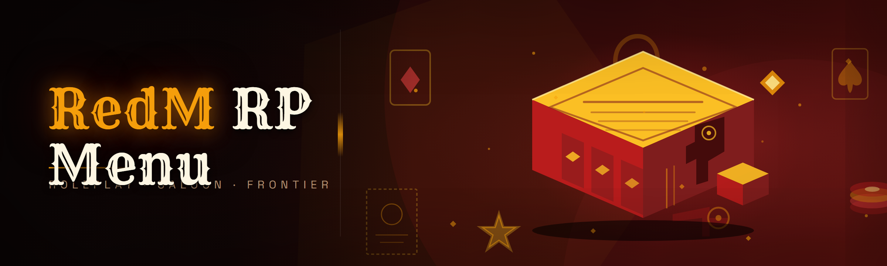

  
  
  

  

  
  

---

RedM RP menu: player ESP, aimbot, godmode, teleport, vehicle spawner and noclip — native RedM Lua mod menu for roleplay servers.

## Overview

RedM RP menu: player ESP, aimbot, godmode, teleport, vehicle spawner and noclip — native RedM Lua mod menu for roleplay servers.

  

## License

[MIT License](LICENSE)

  

